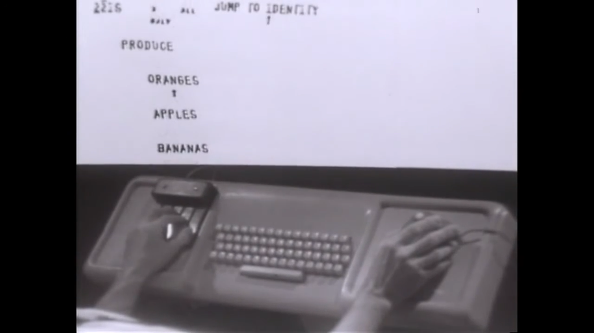

# High-level: User Interface
 
^*Doug Engelbart using the NLS terminal from the comfort of his office setup, which was once used in an open house session. From the Mother of All Demos, 420p remastered.*^

The user interface, to a modern user, appears *arcane*, *eldritch* and generally **inscrutable**. How is the average user going to do anything on here? It's a trick question, you *don't*, unless you're doing knowledge processing a lot or have a striking interest in the NLS, in which case this is for you.

However, it's a stretch to say it's completely unusable. While Xerox's Lisp machines and the Apple Lisa let you access information easily, it was hard to *scrutinize* it at a deeper level. This is where the NLS came in, failure as it was. You could expand on, focus on, cross-link to and from, edit and easily find the cross-references for various types of data. It was essentially a prototypical version of HyperCard and Decker as we know them today.

### Layout in writing
##### Mouse
The mouse cursor (called a *bug* in NLS) can be anywhere on the screen. The left and right buttons are used to click on characters, strings and commands you can use listed in the document. Left clicking without pressing any chords confirms the action the system understands you want it to do after clicking an item. Details on the other two forthcoming.
##### Top level
In the top level you find the following: *Statement ID* (think of a line in text), *layer view* (ALL ALL means you see everything at the top level and the lower levels), *commands* you can use immediately below, command awaiting *confirmation*, and a number I *can't divine* right now. You can see it in the introductory image I put in here.
##### Left edge
On the left edge are identifiers permanently attached to the statement in question, which shows its row and layer (this is one way to find and navigate). Layers are sub-levels to a statement and can be viewed in their entirety by hiding everything else. This can also be done for statements with no additional layers.
##### Central
This is the crux of the whole thing, which exposes the fact that the NLS is not only multi-process, but multi-tasking via "document freezing". Here you can do anything the program permits. If you're coding, the coding program will enable TENEX syntax for processing and testing. If you're working with documents, you can access links, cross-references and so on, and it depends on how it's written.
### Mouse controls
From the NLS User's Guide as preserved by bitsavers: right click accepts a command, and with LIT entered, it references a pointer.

Left clicking without intervention backspaces and cancels the bug's selection (this is handled by the backspace nowadays). When LIT is entered by the keyset and you left click, a "Case 2" input is triggered.

Wheel click triggers a deletion of a loaded command. LIT causes a "Case 1" input instead. "Case 1" turns the letters selected into uppercase when accepted.

Left + wheel deletes an entire word, now handled by Ctrl+Shift+direction-of-word and backspace, and is a "Case 3" input when LIT is entered beforehand.

... I thought that this would be related to the available commands on the top left, but then I remembered there are 4 text sizes you can choose from. By pairing the mouse with the piano, formatting appears to be very easy with practice.
### To be continued...
With a section this long already, I'll have another file [here](nls-interface2.md) to explain how I would replicate this in a semi-modern computing environment.

[Return to RE Index](revenge-of-past.md)

[Go up](#high-level-user-interface)